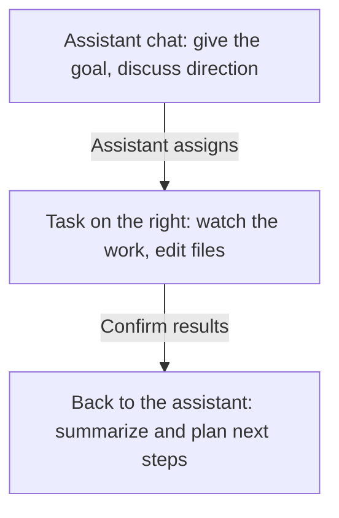

This time, use the personal assistant to prepare group meeting material. Everyday discussion stays in the assistant chat while a worker organizes the files, and both can continue at the same time.

First [set up the personal assistant](/en/assistant) and have the device and folder with the material ready. If you have no material, use the [group meeting practice pack](https://raw.githubusercontent.com/shuxueshuxue/gugu-docs/4a7afce72d77b8dc17468539a65f6684d92869ea/samples/research-starter.zip). Provide only the material you need; you do not have to connect every app first.

What you say to the assistant stays on the left. For specific edits to a file, go into the matching task on the right and say it there. Switching panels does not merge the two chats.

## 1. State the goal and the division of work

> I'm preparing a group meeting. Please hand the literature organizing to a task Agent: read three papers from the material folder I chose and produce a comparison table with sources. Let me check the table first when it's ready. I also want to discuss the meeting's focus with you.

Once you explicitly ask for a task Agent, the assistant should say who it actually assigned the work to. A reply of just "Sure" or a plan does not mean a task has been created.

A one-off organizing job can stand on its own. To work on the same topic over time, choose the matching project. Whether to delegate and whether to create a project are separate decisions.

## 2. Watch the work on the right

Open this item in the assistant's **Tasks**. On desktop, the worker's chat opens on the right, and you can keep chatting with the personal assistant on the left.

On the phone, tap into the worker from the assistant's **Tasks** page, then go back to keep chatting with the assistant.

Add requirements for the worker directly:

> The second paper does not give its data source. Mark it as not provided in the table and do not guess for now.

This message goes to the current task Agent. After returning to the task list, you can tap the same item again to see the earlier history.

## 3. Answer questions that need a decision

When the worker needs key information, the assistant asks you, along with the task it came from. Read the question, the options and the recommendation, then submit your answer.

If you select an option but do not submit, or choose **Answer later**, the question is still undecided. While it waits for your answer, you can keep discussing other things with the assistant.

## 4. Check the output, then have the assistant summarize

Open the literature table in the task, spot-check it against the originals, and once it is confirmed, continue:

> The literature table is confirmed. Based on this version, give me a one-page meeting outline, and include a link to that task so I can continue it later.

For a habit to remember long term, say it separately, for example "Keep all group meeting outlines to one page from now on." Details to change this time stay in the task.

For regular follow-up, specify the time, time zone and where to send results for a [schedule](/en/schedules).
