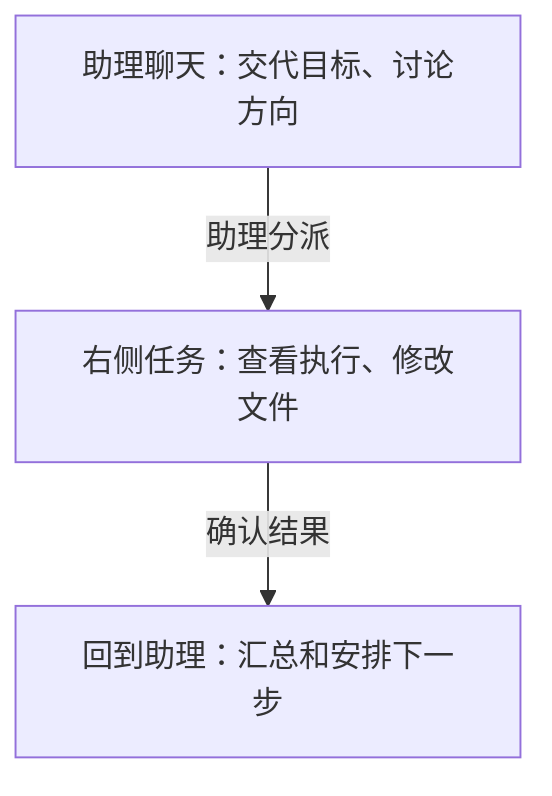

这次用个人助理准备组会材料。日常讨论留在助理聊天里，执行者负责整理文件，两边可以同时继续。

先[开通个人助理](/assistant)，准备好资料所在的设备和文件夹。没有材料时可用[组会练习包](https://raw.githubusercontent.com/shuxueshuxue/gugu-docs/4a7afce72d77b8dc17468539a65f6684d92869ea/samples/research-starter.zip)。需要哪些资料就提供哪些，不必先连接所有应用。

发给助理的话留在左边；对某个文件的具体修改，进入右边对应任务直接说。切换面板不会把两段聊天合成一段。

## 1. 说明目标和分工

> 我要准备组会。请把文献整理交给一位任务 Agent，先从我选定的资料文件夹读三篇，输出带出处的对照表。表格出来后先让我检查，我还想和你讨论组会重点。

明确要求交给任务 Agent 后，助理应说明实际派给谁。仅回复「可以」或一段计划，还不能当成已经创建任务。

临时的一次整理可以独立存在；要长期围绕同一课题工作，再选对应项目。是否委派和是否建项目分别决定。

## 2. 在右侧查看执行

桌面点最左栏顶部的咕咕头像，到助理右侧的「任务」里点开这一项。执行者聊天在右侧展开，左侧仍可继续和个人助理聊。

手机打开「消息」，点最上面一行的助理。助理是单独的一整页，切到「任务」点进执行者；返回后切回「聊天」继续和助理说。

直接给执行者补要求：

> 第二篇没有给出数据来源，请在表中标为未提供，先不要推断。

这句话发给当前任务 Agent。返回任务列表后，仍可再点进同一项看原来的记录。

## 3. 回答需要决定的问题

执行者需要关键信息时，助理会带着任务来源提问。看清问题、选项和推荐，再提交答案。

选中了选项但没有提交，或选择稍后回答，问题仍未决定。等待答案期间，可以继续和助理讨论其他事情。

## 4. 检查产物，再让助理汇总

打开任务里的资料表，按原文抽查，确认后继续：

> 资料表已确认。请根据这个版本给我一页组会提纲，并附上刚才任务的链接，方便我以后继续。

要长期记住的习惯可以另外说明「以后组会提纲都保持一页」；本次要改的细节留在任务里。

定期跟进时，再明确[定时安排](/schedules)的时间、时区和结果发送位置。
